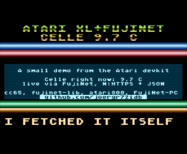
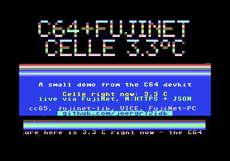
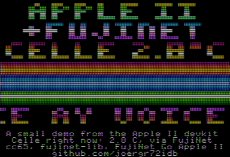

# Development Kit for the C64 and FujiNet

A self-contained toolchain for macOS and Linux for writing C64 programs that use the FujiNet, and testing them
in VICE with an emulated FujiNet on the serial bus. Everything is built into `opt/` inside this
folder; nothing is installed system-wide except a few Homebrew or apt packages.

| Tool | Version | What it is |
|---|---|---|
| [cc65](https://github.com/cc65/cc65) | V2.19 (git) | C compiler (`cl65`) and the **ca65** assembler |
| [fujinet-lib](https://github.com/FujiNetWIFI/fujinet-lib) | 5.1.1 | C library for the FujiNet (network, clock, FujiNet device) |
| [VICE (FujiNet fork)](https://github.com/dillera/vice-fn) | trunk, 2026-11-01 | C64 emulator with real-device support for units 8–30, plus `petcat` and `c1541` |
| NetIEC bridge | same | `libopencbm.dylib` (Linux: `.so`): sends the emulated serial bus over TCP to FujiNet-PC |
| [FujiNet-PC](https://github.com/FujiNetWIFI/fujinet-firmware) | master `8cc29e8b5` | FujiNet firmware for the Commodore bus (incl. the Meatloaf drive code) as a Mac/Linux program |

```
cl65 / petcat ──► build/*.prg ──► VICE x64sc ── bridge (libopencbm) ── TCP 1541 (NetIEC) ──► FujiNet-PC
                                                                    devices 16 network · 29 clock · 30 FujiNet
                                                                    drives 8-15 (Meatloaf) · web UI 127.0.0.1:8001
```

## Setup

```sh
tools/setup-macos.sh           # macOS: Homebrew packages + builds everything missing into opt/
tools/setup-linux.sh           # Linux (Debian/Ubuntu): checks the apt packages, then the same
tools/setup-linux.sh vice      # rebuild single parts: cc65 fujinet-lib fujinet-pc vice
```

Linux needs these packages first (`setup-linux.sh` lists the missing ones and stops):
`sudo apt install build-essential git autoconf automake cmake pkg-config libsdl2-dev libsdl2-image-dev libmbedtls-dev python3-venv libssl-dev libcurl4-openssl-dev unzip curl xa65 dos2unix bison flex texinfo`

Versions are pinned at the top of both setup scripts (keep them in step). Build logs go to `build/logs/`.

## Windows (WSL2) - not tested yet

The kit should run on Windows inside **WSL2** (a real Linux within Windows) with the Linux setup
above. Not tested yet - reports are welcome (GitHub issues).

1. In PowerShell as administrator: `wsl --install -d Ubuntu-26.04` (the kit is tested on Ubuntu
   26.04; older releases lack some packages), restart, create the Linux user.
2. In the Ubuntu window: clone the kit into the Linux home (`~/`), **not** under `/mnt/c/...` -
   that is slow and its file permissions break the build. Then follow the Linux steps above.
3. Emulator windows and sound come through WSLg (Windows 11, or Windows 10 with a current WSL:
   `wsl --update`). `make shot` needs no window.
4. Network: emulator, FujiNet-PC and internet work as on Linux. Connections *into* WSL from other
   machines on the LAN (e.g. a real computer to a server running in WSL) need mirrored networking -
   `%UserProfile%\.wslconfig`:
   ```
   [wsl2]
   networkingMode=mirrored
   ```
   then `wsl --shutdown`, and allow the port in the Windows firewall.

`tools/setup-linux.sh` recognizes WSL and prints these hints (it stops when the kit is under `/mnt/`).

## Use

```sh
make                           # samples: build/hello-c.prg, hello-asm.prg, hello-bas.prg, demo.prg + build/samples.d64
make run                       # FujiNet-PC + VICE with the C sample
make run PRG=build/hello-bas.prg
make run UNITS="8 16 29 30"    # also drive 8 from FujiNet-PC (Meatloaf drive) instead of VICE's own
make config                    # VICE with FujiNet as drive 8, for FujiNet's CONFIG: LOAD"CONFIG.PRG",8
make stop                      # stops this kit's FujiNet-PC
make shot                      # headless run, no window: build/shot.png + build/shot.txt + build/shot.wav
make shot PRG=my.prg FRAMES=900 KEYS='wait 350; type hello; key RETURN; joy up+fire 20'
```

`make shot` is for checking a program without watching it (scripts, AI assistants): VICE runs
without a window for `FRAMES` frames (default 600 = 12 s PAL, timed by the clock), gets the keys and
joystick moves in `KEYS` through its binary monitor (127.0.0.1:`MON_PORT`, default 6520), and at
the end `build/shot.png` (the screen) and `build/shot.txt` (the text screen as plain text) are
written. The sound of the whole run goes to `build/shot.wav` (VICE's `wav` sound device; e.g.
`ffmpeg -i build/shot.wav -lavfi showspectrumpic=s=1200x500 spec.png` shows the notes without
listening). While a program talks to the FujiNet, the emulation waits for the bus, so the WAV
can be a few seconds shorter than the run. FujiNet-PC is started as for `make run` and keeps running (`make stop`).

`KEYS` (`tools/c64shot.py`): commands separated by `;` - `wait N` (frames), `type TEXT` (through the
keyboard buffer, as BASIC and cc65's `cgetc` read it; upper case letters come out shifted), `key NAME`
(RETURN DEL HOME CLR UP DOWN LEFT RIGHT F1-F8 RUNSTOP SPACE or a character, also through the buffer),
`press NAME [N]` (held in the keyboard matrix, for programs that scan it themselves; also RESTORE;
several keys at once with `+`, e.g. `press RUNSTOP+RESTORE` or `press LSHIFT+X`),
`joy DIR [N]` / `joy1 DIR [N]` (port 2 / port 1: up, down, left, right, upleft, ..., with `+fire`, or
`fire`). As on a real C64, joystick 1 also shows up as key presses.

**FujiNet CONFIG on the C64:** pick a host with the cursor keys + RETURN, a file with RETURN, then
the drive slot (1–8 or cursor keys) and RETURN (read only) or W (read/write). The C64 **←** key
(Mac: **§** or **ß**; German PC keyboard on Linux: **ß**) leaves CONFIG and boots the mounted disk.

Samples in `samples/`:
- `hello.c` – C with fujinet-lib: asks the FujiNet for its version, hostname and IP address.
- `hello.s` – ca65 assembler: prints a line through the KERNAL.
- `hello.bas` – C64 BASIC, tokenized with `petcat`.
- `demo.c` + `demo.s` – a small demoscene-style screen: a big logo whose letters are holes in black
  quadrant characters, with a rainbow behind them, raster bars, a smooth scroller ($D016, reverse
  characters with a rainbow behind them as well), a 3-voice SID tune (melody with pulse width
  modulation, chord arpeggio, drums and bass on one voice) and the current temperature in Celle,
  fetched through FujiNet (N:HTTPS + JSON). Two raster interrupts per frame set the background
  colour line by line; C does the network part and the texts, assembler everything that moves. It is
  the C64 version of the Atari kit's demo, with the same tune. `make run PRG=build/demo.prg`.

  

  An AI assistant (Claude Code) generated the demo from this prompt, after it had made the Atari
  kit's demo; no code was written by hand. The assistant checked it in the kit's headless loop
  (`make shot`: screenshots, a zoomed crop, a spectrogram of `build/shot.wav`) and fixed what it found
  there: the URL had been converted to ASCII by hand, but the FujiNet converts PETSCII device specs
  itself; the border colour lagged one line behind (so the border now stays black); one panel line
  was hard to read. The WAV recording in `make shot` was added for this demo.

  > hello. i like to build such a demo program for the c64 like we did for the atari toolchain... Is
  > that possible?

Without a running emulator, `opt/vice-bridge/netiecctl` talks to FujiNet-PC directly:
`netiecctl status 8`, `netiecctl dir 8`, `netiecctl fuji e8` (adapter config).

## The same demo on four machines

The kits for the Atari XL, the C64, the CPC and the Apple II each have this demo as a sample: the same
tune and the temperature in Celle, fetched live over the network - each made with its own machine's means.

| [Atari XL + FujiNet](https://github.com/joergr72idb/development-kit-atari-xl-and-fujinet) | [C64 + FujiNet](https://github.com/joergr72idb/development-kit-c64-and-fujinet) |
|:---:|:---:|
|  |  |
| display list interrupts, fine scrolling with HSCROL, POKEY | letters as holes in characters with a rainbow behind them, $D016, SID |
| **[CPC + M4](https://github.com/joergr72idb/development-kit-cpc-and-m4)** | **[Apple II + FujiNet](https://github.com/joergr72idb/development-kit-apple2-and-fujinet)** |
|  |  |
| Gate Array colours on every scan line, counted to the microsecond, AY | lo-res drawn again every frame into the hidden page, Mockingboard |

## Notes

- **ASCII vs. PETSCII:** FujiNet sends ASCII; on the C64 the two cases are swapped and ASCII
  lowercase shows as graphics characters. Convert text from the FujiNet before printing
  (see `ascii2pet()` in `samples/hello.c`).
- **Meatloaf on FujiNet-PC** has the drive code, but not Meatloaf's HTTP, TNFS and `ML:` file
  systems (they need the ESP32's software). `OPEN 1,8,3,"http://..."` as used by the Meatloaf
  clients of [Retro Tron Battle](https://github.com/joergr72idb/retro-tron-battle) /
  [Retro Game Battle](https://github.com/joergr72idb/retro-game-battle) did **not** work here; network access goes
  through the FujiNet devices (fujinet-lib) instead.
- Only the standard IEC protocol: no JiffyDOS or other fast loaders on the FujiNet units.
- fujinet-lib programs built before 5.1.1 misread every reply from current firmware.
- **Ports:** web UI `127.0.0.1:8001`, NetIEC TCP 1541 (`WEB_PORT` / `NETIEC_PORT` in the Makefile).
  The Atari kit uses 8000 and UDP 9997, so both kits run side by side. `make run` checks the ports
  first (`tools/check-ports`) and stops with the reason when another program (e.g. another
  FujiNet-PC) has them, or when another VICE is already connected to this FujiNet-PC; then use
  other ports: `make run NETIEC_PORT=1542 WEB_PORT=8003`.
- The web UI has no login; it listens on 127.0.0.1 only, so it isn't reachable from the network.
- **Keyboard:** `keymaps/c64-mac-de.vkm` = VICE's German map plus the C64 ← key on §, ß and `.
- VICE's settings and log stay in `build/` (`-config build/vicerc`, `-logfile`), never in the home folder.
- **Real hardware:** the Meatloaf board (LOLIN D32 Pro) can also run FujiNet's `fujinet-iec-lolin-d32`
  firmware – same pins (ATN 32, CLK 33, DATA 25, SRQ 26, RESET 34).

## Built on the work of others

This kit is only glue: setup scripts that download and build other people's software at fixed
versions, plus Makefiles and settings that wire it together. Everything that does the real work
comes from these projects - used unmodified. **A warm thank you to all their maintainers and
contributors!**

- [cc65](https://github.com/cc65/cc65) - the C compiler and ca65 assembler
- [fujinet-lib](https://github.com/FujiNetWIFI/fujinet-lib) - the C library for the FujiNet
- [vice-fn](https://github.com/dillera/vice-fn) by Andy Diller - the FujiNet fork of VICE with the NetIEC
  bridge that connects the emulated serial bus to FujiNet-PC
- [VICE](https://vice-emu.sourceforge.io/) ([sources](https://github.com/VICE-Team/svn-mirror)) - the emulator
  that fork is built on, with `c1541` and `petcat`
- [FujiNet firmware](https://github.com/FujiNetWIFI/fujinet-firmware) - built here as FujiNet-PC for the
  Commodore bus, including the drive code from [Meatloaf](https://github.com/idolpx/meatloaf)
- the [FujiNet project](https://fujinet.online) as a whole - the hardware this kit is about

**Underneath:** [Homebrew](https://github.com/Homebrew/brew) or Debian/Ubuntu packages, [SDL](https://github.com/libsdl-org/SDL) and
[SDL_image](https://github.com/libsdl-org/SDL_image), [Mbed TLS](https://github.com/Mbed-TLS/mbedtls),
[CMake](https://github.com/Kitware/CMake), [pkgconf](https://github.com/pkgconf/pkgconf),
[xa](https://www.floodgap.com/retrotech/xa/), [GNU Bison](https://www.gnu.org/software/bison/),
[dos2unix](https://waterlan.home.xs4all.nl/dos2unix.html), [GNU Autoconf](https://www.gnu.org/software/autoconf/)
and [Automake](https://www.gnu.org/software/automake/).
