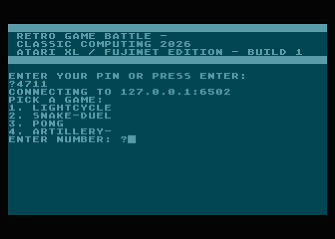
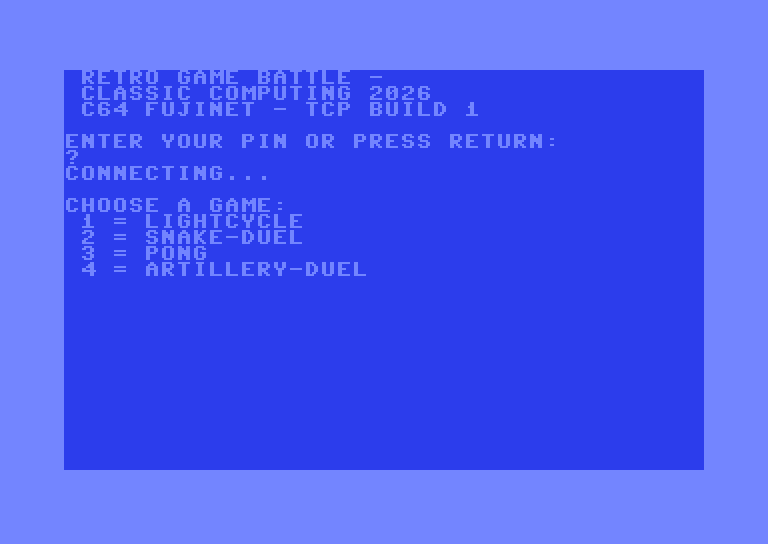
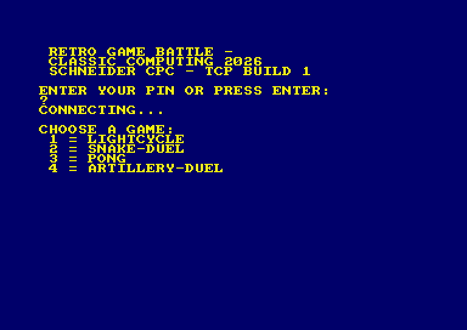
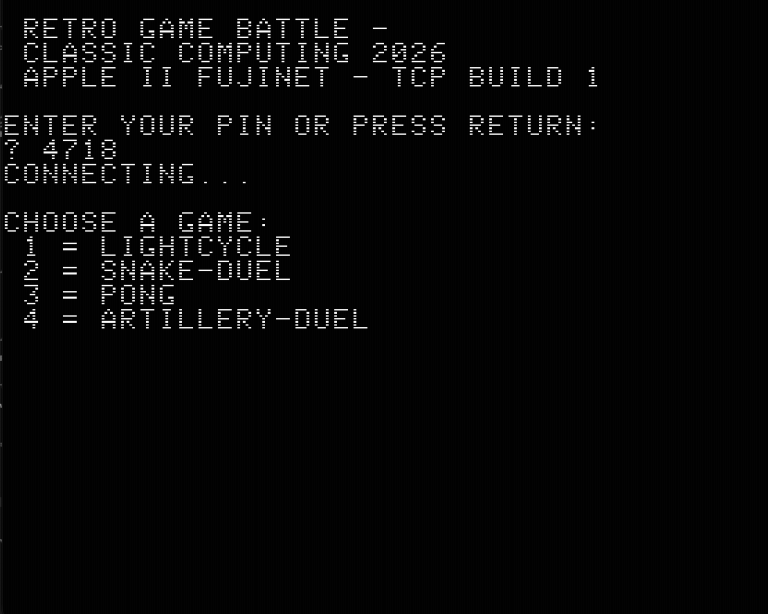

# Retro Game Battle

Multi-game successor to [Retro Tron Battle](../retro-tron-battle) (built
for Classic Computing 2026): real retro computers (Atari XL/XE, Commodore 64 and Apple II via
FujiNet, Schneider/Amstrad CPC via an M4 board) steer via joystick over the network while a Python/pygame
server on a modern PC draws the whole board and runs the game logic.

New here: the **first connecting client picks which game to play** from
a server-provided list; the second client is auto-matched into it. New
games are added as plugins (`server/games/<name>.py`) without touching
the shared transport/pairing/rendering code or any existing client.

Games in this pass: **Tron** (ported rule-for-rule from Retro Tron
Battle) and **Snake** (new - a food-eating duel using the same
grid/tick model). See `docs/protocol.md` for the full wire protocol and
`server/games/base.py` for the plugin interface.

## Running the server

```
cd server
python3 game_battle_server.py [host] [tcp_port] [http_port]
# defaults: 0.0.0.0 6502 8080
# add --headless to skip the pygame window (useful for bot-only testing)
```

Requires `pip install pygame` unless run with `--headless`.

## Testing without hardware

`bots/game_bot.sh [HOST] [PORT] [PLATFORM] [NAME] [VARIANT] [WANT_GAME] [TURN_CHANCE] [PIN]`
simulates a client over TCP, including the game-selection step - see the
script's own header comment for examples (including how to exercise the
compatibility-filtering behavior with a `C64-WIC64` variant).

## Docs

- `docs/protocol.md` - the wire protocol (source of truth)
- `docs/howto-devkits.md` - how to build the four development kits (Atari, C64, CPC, Apple II)
  and run each client in its emulator
- `devkits/` - the four development kits themselves (build scripts, configs, our M4 library, samples)
- `docs/pap_diagrams.pdf` - PAP flowcharts for explaining the games to
  visitors (page 1) and the server logic (page 2); regenerate with
  `docs/pap_src/build.sh` from the `.dot` sources there

## Clients

All clients speak the raw TCP protocol (`docs/protocol.md`, "Protocol 1"): one connection per
match, a `MOVE` only when the stick changes, `FIRE` on the button (Artillery).

- `clients/atari/game_battle_atari_client.bas` - Atari XL/XE + FujiNet (Atari BASIC)
- `clients/atari-tcp/` - Atari XL/XE + FujiNet (C, cc65 + fujinet-lib; boots directly as an XEX)
- `clients/c64-tcp/` - C64 + FujiNet (C, cc65 + fujinet-lib)
- `clients/cpc-tcp/` - Schneider/Amstrad CPC + M4 board (C, SDCC + the M4 library)
- `clients/apple2-tcp/` - Apple //e enhanced or later + FujiNet (C, cc65 + fujinet-lib)

Game menu of each client (emulators, server on 127.0.0.1):

| Atari XL + FujiNet | C64 + FujiNet |
|---|---|
|  |  |
| **CPC + M4** | **Apple II + FujiNet** |
|  |  |

The C clients are built with the development kits next to this repository
(`../development-kit-c64-and-fujinet`, `../development-kit-cpc-and-m4`,
`../development-kit-apple2-and-fujinet`), which also run them in emulators (VICE + FujiNet-PC,
CPCSyntaxError with M4, FujiNet Go Apple II). Ready-made disk images: `disk-images/`.
How to build the kits and run each client in its emulator:
[`docs/howto-devkits.md`](docs/howto-devkits.md).

The HTTP-polling BASIC clients (C64 Meatloaf, C64 WiC64, CPC `|HTTPMEM`) were dropped on
2026-11-14: they waited up to 0.3-1.3 s per tick for the network while the server runs 250 ms
ticks. They are in the git history (and in retro-tron-battle). The server keeps its HTTP bridge
(port 8080), so such clients still work against it.

The hardware/platform lessons in
[`retro-tron-battle/CLAUDE.md`](../retro-tron-battle/CLAUDE.md) (PETSCII case-folding, reserved
BASIC keywords, joystick port quirks, `RUN`-not-`GOTO` restarts, and so on) still apply.

## Thanks

Hans has developed the fotofix idea - many thanks from here!

### The projects our development kits are built on

None of the clients would exist without the open-source work of these projects. Our kits
(`devkits/`) only pin, build and wire them together - the real work is theirs. A warm thank you
to all their maintainers and contributors!

**Compilers, assemblers, libraries**
- [cc65](https://github.com/cc65/cc65) - C compiler and ca65 assembler for the 6502 (Atari, C64, Apple II)
- [fujinet-lib](https://github.com/FujiNetWIFI/fujinet-lib) - the C library for the FujiNet
- [FastBasic](https://github.com/dmsc/fastbasic) - a fast, modern BASIC for the Atari
- [SDCC](https://sdcc.sourceforge.net/) ([sources](https://sourceforge.net/projects/sdcc/)) - the Z80 C compiler for the CPC
- [RASM](https://github.com/EdouardBERGE/rasm) - Z80 assembler
- [iDSK](https://github.com/cpcsdk/idsk) - CPC disc images
- [cadius](https://github.com/mach-kernel/cadius) - ProDOS disk images (originally by Brutal Deluxe)
- [ProDOS 8 releases](https://github.com/ProDOS-8/ProDOS8-Releases) - ProDOS 2.4.3 for the Apple II boot disk

**FujiNet, M4 and the emulators**
- [FujiNet firmware / FujiNet-PC](https://github.com/FujiNetWIFI/fujinet-firmware) - the FujiNet for the Atari (NetSIO) and the Commodore bus (NetIEC)
- [FujiNet Go Apple II](https://github.com/FujiNetWIFI/fujinet-go-apple2-desktop) - Apple II emulator with FujiNet built in, on [AppleWin](https://github.com/AppleWin/AppleWin) ([FujiNet's AppleWin fork](https://github.com/FujiNetWIFI/AppleWin))
- [atari800](https://github.com/atari800/atari800) - Atari 8-bit emulator with NetSIO
- [vice-fn](https://github.com/dillera/vice-fn) - the FujiNet fork of [VICE](https://vice-emu.sourceforge.io/) ([VICE-Team/svn-mirror](https://github.com/VICE-Team/svn-mirror)) with the NetIEC bridge
- [CPCSyntaxError](https://github.com/WacKEDmaN/CPCSyntaxError) - CPC emulator with M4 board emulation
- The [M4 board](http://www.spinpoint.org/) by [Duke](https://github.com/M4Duke) - its ROM and the documented command interface ([m4info.txt](http://www.spinpoint.org/cpc/m4info.txt)) our `lib/m4` is written from

**Underneath**
- [Homebrew](https://github.com/Homebrew/brew), [SDL](https://github.com/libsdl-org/SDL),
  [Mbed TLS](https://github.com/Mbed-TLS/mbedtls), [CMake](https://github.com/Kitware/CMake),
  [Ninja](https://github.com/ninja-build/ninja), [Boost](https://github.com/boostorg/boost),
  [GNU Bison](https://www.gnu.org/software/bison/), [xa](https://www.floodgap.com/retrotech/xa/),
  [Python](https://github.com/python/cpython) and [pygame](https://github.com/pygame/pygame) for the server

## Not in this pass

- Pong and a Gorilla-style artillery game (see `docs/protocol.md`'s
  "Adding a new game" section for why Gorilla in particular needs a
  different input model).
- The Apple II BASIC draft of the reference repo wasn't carried over - `clients/apple2-tcp/`
  is a new client in C.
