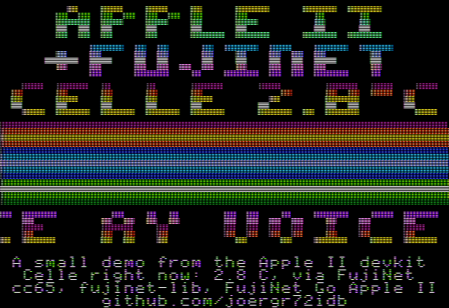
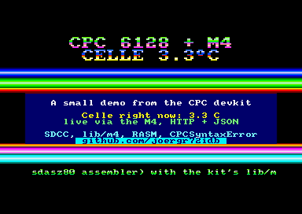

# Development Kit for the Apple II and FujiNet

A self-contained toolchain for macOS and Linux for Apple II programs that use the FujiNet, tested in an emulator
with FujiNet built in. Everything is built into `opt/` inside this folder.

| Tool | Version | What it is |
|---|---|---|
| [cc65](https://github.com/cc65/cc65) | V2.19 (git) | C compiler and ca65 assembler (`-t apple2enh`) |
| [fujinet-lib](https://github.com/FujiNetWIFI/fujinet-lib) | 5.1.1 | C library for the FujiNet (SmartPort) |
| [cadius](https://github.com/mach-kernel/cadius) | 1.4.5 | ProDOS disk images (`.po`) |
| [ProDOS](https://github.com/ProDOS-8/ProDOS8-Releases) | 2.4.3 | `PRODOS` + boot blocks for boot disks (no licence stated: never committed) |
| [FujiNet Go Apple II](https://github.com/FujiNetWIFI/fujinet-go-apple2-desktop) | 0.10.0 | Emulator (GPLv3): AppleWin core + FujiNet firmware in one app, boots into CONFIG |

## Setup and use

```sh
tools/setup-macos.sh                 # macOS: Homebrew packages + everything missing into opt/
tools/setup-linux.sh                 # Linux (Debian/Ubuntu): checks the apt packages, then the same
make                                 # the demo sample: build/demo.po (ProDOS boot disk)
make run DISK=path/to/disk.po        # put the disk on the emulated FujiNet's SD card, start the emulator
make shot DISK=disk.po KEYS='wait 400; type Hello; key RETURN'   # headless run, see below
```

Linux needs these packages first (`setup-linux.sh` lists the missing ones and stops):
`sudo apt install build-essential git cmake ninja-build python3 libsdl3-dev libboost-dev zlib1g-dev libgtk-4-dev libadwaita-1-dev libssl-dev unzip curl`

On Linux the emulator is the GNOME frontend (`opt/fngo/fujinet-go-apple2-gnome`), on macOS the app.

In CONFIG: host **SD** → the image → drive slot **1** → **ESC** boots it.

A cc65 program for ProDOS: `cl65 -t apple2enh -C apple2enh-system.cfg` gives a SYS file; on a disk
with `PRODOS` and the ProDOS boot blocks, the first `*.SYSTEM` file starts by itself (see
`clients/apple2-tcp/Makefile` in [Retro Game Battle](https://github.com/joergr72idb/retro-game-battle)). Call `network_init()` before other fujinet-lib
network calls - on the Apple II it finds the network device on the SmartPort.

## Windows (WSL2) - not tested yet

The kit should run on Windows inside **WSL2** (a real Linux within Windows) with the Linux setup
above. Not tested yet - reports are welcome (GitHub issues).

1. In PowerShell as administrator: `wsl --install -d Ubuntu-26.04` (the kit is tested on Ubuntu
   26.04; older releases lack some packages), restart, create the Linux user.
2. In the Ubuntu window: clone the kit into the Linux home (`~/`), **not** under `/mnt/c/...` -
   that is slow and its file permissions break the build. Then follow the Linux steps above.
3. Emulator windows and sound come through WSLg (Windows 11, or Windows 10 with a current WSL:
   `wsl --update`). `make shot` needs no window.
4. Network: emulator, FujiNet-PC and internet work as on Linux. Connections *into* WSL from other
   machines on the LAN (e.g. a real computer to a server running in WSL) need mirrored networking -
   `%UserProfile%\.wslconfig`:
   ```
   [wsl2]
   networkingMode=mirrored
   ```
   then `wsl --shutdown`, and allow the port in the Windows firewall.

`tools/setup-linux.sh` recognizes WSL and prints these hints (it stops when the kit is under `/mnt/`).

## Headless runs: `make shot`

For checking a program without watching it (scripts, AI assistants): `make shot` runs the emulator
without a window, boots `DISK` straight away (CONFIG off, the disk in drive slot 1), types `KEYS` and
after `FRAMES` frames (default 900 = 15 s at 60 Hz) writes

- `build/shot.png` - the screen,
- `build/shot.txt` - the 40-column text screen as plain text (page 1, $0400),
- `build/shot.fujinet.log` - FujiNet's console output,
- `build/shot.wav` - the sound of the whole run (speaker and Mockingboard, 44.1 kHz stereo; e.g.
  `ffmpeg -i build/shot.wav -lavfi showspectrumpic=s=1200x500 spec.png` shows the notes).

`PEEK=addr:len` (hex address) prints that memory at the end of the run, with `PEEK_EVERY=N` also
every N frames while it runs - e.g. a program's frame counter or the state of its music player
(`PEEK=5AFB:1 make shot ...`; the addresses are in the program's map file).

Without `DISK` it stays in CONFIG. `KEYS`: commands separated by `;`, one after another from
power-on - `wait N` (frames), `type TEXT` (arrives as written, upper and lower case), `key NAME [N]`
(RETURN ESC TAB BACKSPACE DELETE UP DOWN LEFT RIGHT SPACE, a character, `CTRL-x`), `joy DIR [N]`
(the paddles as a joystick: left, right, up, down, upleft, ..., center), `button 0|1 [N]` (Open /
Closed Apple), `reset [cold]`. The script is checked before the emulator starts.

It is `tools/a2shot.c`, a small program on FujiNet Go's own session library (built by the setup
script in `build/fngo`; the a2shot binary is GPL-3 like it). It has its own settings and SD card in
`build/shot-config` and `build/shot-data`, so `make run` keeps its CONFIG settings. The emulator's
ports are fixed, so it refuses while `make run` is open.

## The demo (`samples/demo.c`, `samples/demo_fx.s`)

A small demoscene-style screen: a logo in a 3x5 block font with a rainbow running through it,
raster bars, a scroller in the same font with a rainbow, a 4-line info panel, a 3-voice tune on
the Mockingboard (melody, chord arpeggio, drums and bass sharing one voice) and the current
temperature in Celle, which the Apple II fetches itself through FujiNet (N:HTTPS + JSON from
open-meteo.com). It is the Apple II version of the Atari, C64 and CPC kits' demos, with the same
tune. `make` builds `build/demo.po`; `make run DISK=build/demo.po`, then in CONFIG pick it from
the SD card into slot 1 and boot (ESC). Or headless: `make shot DISK=build/demo.po FRAMES=1500`.



How it works: the Apple II has no colour registers or raster interrupts, so the demo uses lo-res
graphics (40 x 40 colour blocks) with 4 text lines below (mixed mode) and draws every frame again
into the hidden page, which it shows at the next vertical blank (`$C019`). Per text row there are
only 4 possible bytes (letter or background, top and bottom block); a mask per column picks one.
The scroller rows are ring buffers, so a step costs a few bytes instead of a copy. Everything fits
into one frame: 60 frames per second. The music is the AY player of the CPC demo in 6502 code; the
Mockingboard in slot 4 gets the same registers on both chips.

An AI assistant (Claude Code) generated the demo from this prompt, after it had made the Atari, C64
and CPC demos; no code was written by hand. It checked the demo with `make shot`: screenshots, the
frame counter read 100 frames apart (`PEEK`, added for this) and the music player's state traced
every second (`PEEK_EVERY`), plus a spectrogram of the new `build/shot.wav`. It fixed what it found
there: the first version ran at 30 frames per second (faster drawing loops, the ring buffers), and a
register clobbered by a subroutine left the music player's start values random.

> now build the same demo for the apple II toolchain

## The same demo on four machines

The kits for the Atari XL, the C64, the CPC and the Apple II each have this demo as a sample: the same
tune and the temperature in Celle, fetched live over the network - each made with its own machine's means.

| [Atari XL + FujiNet](https://github.com/joergr72idb/development-kit-atari-xl-and-fujinet) | [C64 + FujiNet](https://github.com/joergr72idb/development-kit-c64-and-fujinet) |
|:---:|:---:|
|  |  |
| display list interrupts, fine scrolling with HSCROL, POKEY | letters as holes in characters with a rainbow behind them, $D016, SID |
| **[CPC + M4](https://github.com/joergr72idb/development-kit-cpc-and-m4)** | **[Apple II + FujiNet](https://github.com/joergr72idb/development-kit-apple2-and-fujinet)** |
|  |  |
| Gate Array colours on every scan line, counted to the microsecond, AY | lo-res drawn again every frame into the hidden page, Mockingboard |

## Notes

- The emulator keeps settings and data in `build/xdg-config` and `build/xdg-data` (`XDG_*`), not in
  the home folder. Its FujiNet SD card: `build/xdg-data/fujinet-go-apple2/fujinet/SD`.
- `make run` has no remote control: CONFIG and the program are driven by hand (or use `make shot`).
  FujiNet's log is `build/xdg-data/fujinet-go-apple2/fujinet/fujinet-console.log`.
- Ports 1985 and 64001 (127.0.0.1) - no conflict with the Atari (8000, UDP 9997), C64 (8001, 1541)
  and CPC (8765) kits or the game server (6502, 8080).
- FujiNet's own `autorun.po` boots without ProDOS: its boot block loads `CONFIG.SYSTEM` by name, so it
  can't be reused for other programs.

## Built on the work of others

This kit is only glue: setup scripts that download and build other people's software at fixed
versions, plus Makefiles and settings that wire it together. Everything that does the real work
comes from these projects - used unmodified. **A warm thank you to all their maintainers and
contributors!**

- [cc65](https://github.com/cc65/cc65) - the C compiler and ca65 assembler
- [fujinet-lib](https://github.com/FujiNetWIFI/fujinet-lib) - the C library for the FujiNet
- [cadius](https://github.com/mach-kernel/cadius) - ProDOS disk images (originally by Brutal Deluxe)
- [ProDOS 8](https://github.com/ProDOS-8/ProDOS8-Releases) - ProDOS 2.4.3 for the boot disks (downloaded, never
  redistributed: the release repository states no licence)
- [FujiNet Go Apple II](https://github.com/FujiNetWIFI/fujinet-go-apple2-desktop) - the emulator, built on
  [AppleWin](https://github.com/AppleWin/AppleWin) ([FujiNet's AppleWin fork](https://github.com/FujiNetWIFI/AppleWin))
  with the [FujiNet firmware](https://github.com/FujiNetWIFI/fujinet-firmware) built in
- the [FujiNet project](https://fujinet.online) as a whole - the hardware this kit is about

**Underneath:** [Homebrew](https://github.com/Homebrew/brew) or Debian/Ubuntu packages, [SDL](https://github.com/libsdl-org/SDL),
[Boost](https://github.com/boostorg/boost), [CMake](https://github.com/Kitware/CMake) and
[Ninja](https://github.com/ninja-build/ninja).
